# Incident Report: Operation Quiet Vendor

- **Investigating analyst:** Samarth Badola
- **Programme:** Hackrange Mentorship, Week 9: The Investigation
- **SIEM:** Splunk
- **Log sources:** Windows Security, Linux auth, proxy, VPN, mail gateway, Sysmon
- **Classification:** Confirmed intrusion with data exfiltration
- **Timestamps:** UTC throughout

---

## 1. Executive Summary

Between 12 and 15 June 2026, a phished vendor account was used to move through our network, escalate privileges and send approximately 2GB of company data, including payroll records, to an external file-sharing domain. The attacker was active for about 3.5 hours and left three persistence mechanisms in place that have not yet been removed. We need approval today to disable the compromised accounts, take the affected file server offline and bring in Legal and HR to assess the exposure of employee payroll data.

---

## 2. Timeline

| Time (UTC) | Event |
|---|---|
| 2026-06-12 14:22:00 | Phishing email from `it-support@microsoft-verify.com` delivered to the vendor account `svc-northwind`, asking the recipient to reauthenticate a VPN certificate through a link on the lookalike domain. The mail gateway scored it 6, noted "external lookalike domain" and delivered it anyway |
| 2026-06-15 02:14:00 | First malicious VPN login as `svc-northwind` from `45.132.192.77` (Romania, ASN AS200651), logged as the first connection from that ASN. The session was assigned internal IP `10.20.99.20` |
| 2026-06-15 02:20:29 to 02:34:00 | On `JUMP01`, the attacker ran Active Directory reconnaissance and then Rubeus to Kerberoast service accounts |
| 2026-06-15 02:56:00 | Network logon (Type 3) to `FS01` as `svc-sqlbackup` from `10.20.99.20`, 22 minutes after the Kerberoasting run |
| 2026-06-15 03:00:00 | Root read of `/export/finance/payroll_2026.xlsx` on `FS01`, recorded in the Linux auth log and made possible by the `no_root_squash` NFS setting |
| 2026-06-15 03:11:00 | Scheduled task `UpdateSync` created on `FS01` to run `C:\Windows\Temp\us.exe` at every system start as SYSTEM |
| 2026-06-15 03:13:00 | `svc-sqlbackup` added to the Administrators group on `DC01` by `svc-northwind` |
| 2026-06-15 03:14:00 | New account `svc-helpdesk2` created on `DC01` by `svc-northwind` |
| 2026-06-15 04:58:07 to 05:37:19 | 14 uploads from `FS01` to `filedropzone.io` under `svc-sqlbackup`, one about every three minutes, totalling 2,027,561,102 bytes (about 2.03GB) |
| 2026-06-15 05:50:00 | Windows Security audit log on `FS01` cleared by `svc-sqlbackup` |

- **Dwell time before first use of the stolen credential:** about 2 days 12 hours (phishing delivery to first malicious login)
- **Active intrusion window:** about 3 hours 36 minutes (first malicious login to log clearing)

---

## 3. Impact

- **Systems:** `JUMP01` (reconnaissance and Kerberoasting), `FS01` (lateral movement target, source of the stolen data, scheduled task, log cleared) and `DC01` (Administrators group change and an attacker-created account)
- **Accounts:** `svc-northwind` and `svc-sqlbackup` are compromised. `svc-sqlbackup` now holds Administrators membership on a domain controller. `svc-helpdesk2` was created by the attacker
- **Data:** about 2.03GB sent to `filedropzone.io`, an external domain not previously seen on the network. The Linux auth log records `/export/finance/payroll_2026.xlsx` being read as root on `FS01` at 03:00:00. The proxy log records transfer volume and not filenames
- **Persistence:** three mechanisms were created (a scheduled task on `FS01`, an Administrators group change on `DC01` and a new account on `DC01`).
- **Evidence integrity:** the local Security log on `FS01` was cleared at 05:50:00, so local evidence from before that time may be lost. This investigation relied on events already forwarded to Splunk

---

## 4. Findings and Root Cause

Three weaknesses made this attack possible. Each is fixable.

**F1. The vendor account could be phished and then log in from anywhere.** The mail gateway scored the phishing email 6 and labelled the sender a lookalike domain, but delivered it. Two days later the VPN accepted a login from a country and network the account had never used, recorded it as `result=success` and noted the novelty only in a comment field. Nothing in the logs shows the login was challenged or blocked.

**F2. A service account was open to Kerberoasting.** Kerberoasting only works against accounts with a service principal name, and any authenticated domain account can request those tickets. `svc-sqlbackup` authenticated from the attacker's session IP 22 minutes after Rubeus ran, which indicates its ticket was cracked. The cracking happened off the network and is not visible in the logs.

**F3. The NFS export on `FS01` used `no_root_squash`.** The Linux auth log recorded a read of `/export/finance/payroll_2026.xlsx` at `uid=0`, with the note `root_access_via_no_root_squash`. That setting is what put the payroll file within reach regardless of its file permissions.

**Contributing factors**

- **Excess privileges on the vendor account.** Windows Security events on `DC01` show `svc-northwind` adding `svc-sqlbackup` to the Administrators group (03:13:00) and creating `svc-helpdesk2` (03:14:00). Administrators membership on a domain controller carries domain-wide rights, and a vendor account should not be able to make either change. The logs do not show how it obtained that ability.
- **Warnings were recorded but not acted on.** The lookalike-domain note (12 June), the first-ASN note (02:14) and the reconnaissance commands on `JUMP01` (02:20 to 02:34) all preceded the exfiltration, and the proxy tagged each of the 14 uploads `large_upload` as it happened. The first alert raised was the DLP alert on the transfer itself.
- **Evasion.** The attacker split the transfer into 14 uploads of 140.5MB to 148.7MB (mean 144.8MB), which suggests an attempt to stay under a size threshold, and cleared the audit log about 13 minutes after the last upload. The DLP system flagged the activity regardless.

---

## 5. Recommendations

Effort is an estimate.

| # | Action | Fixes | Effort |
|---|---|---|---|
| | **Immediate (today)** | | |
| 1 | Take a forensic image of `FS01`, then isolate it from the network. Image first, because removing persistence before imaging destroys evidence | Evidence, F3 | Low (file server unavailable until cleared) |
| 2 | Disable `svc-northwind` and `svc-sqlbackup`, revoke their active sessions and reset both credentials before any re-enablement | F1, F2 | Low |
| 3 | After imaging, remove the `UpdateSync` task and `C:\Windows\Temp\us.exe` from `FS01` | Persistence | Low |
| 4 | On `DC01`, remove `svc-sqlbackup` from the Administrators group and disable `svc-helpdesk2` | Persistence | Low |
| 5 | Block `filedropzone.io`, `microsoft-verify.com` and `45.132.192.77` at the proxy and firewall | F1 | Low |
| 6 | Bring in Legal and HR to assess notification obligations for the exposed payroll data | Impact | Low |
| | **This week** | | |
| 7 | Set `root_squash` on the affected NFS export | F3 | Low |
| 8 | Treat `DC01` as potentially compromised: audit Administrators and Domain Admins membership, review every change made by `svc-northwind` and `svc-sqlbackup` since 02:14 and decide whether further credential resets, including `krbtgt`, are needed | F2, Contributing | Medium to high |
| 9 | Search the mail gateway for other messages from `microsoft-verify.com` and identify every recipient | F1 | Low |
| 10 | List everything that was reachable through the export to establish the full scope of data exposure | F3 | Medium |
| 11 | Review `svc-northwind` privileges and establish how it could modify the Administrators group and create accounts on `DC01` | Contributing | Medium |
| | **Longer term** | | |
| 12 | Require MFA and location or network conditions on vendor and service VPN access | F1 | Medium |
| 13 | Move accounts with service principal names to long random passwords or group managed service accounts | F2 | Medium to high |
| 14 | Alert in real time on first-seen VPN networks, `large_upload` proxy tags, Event Code 1102, additions to the Administrators group and Kerberoasting activity. Forwarding to Splunk already preserved the evidence here and should stay in place | Contributing | Medium |

---

## 6. Evidence and Indicators

### Indicators of compromise

| Type | Value |
|---|---|
| Exfiltration domain | `filedropzone[.]io` |
| Phishing domain | `microsoft-verify[.]com` |
| Phishing sender | `it-support@microsoft-verify[.]com` |
| Phishing link | `hxxps://microsoft-verify[.]com/sso/vpn` |
| Attacker IP | `45[.]132[.]192[.]77` (AS200651, Romania) |
| Internal VPN-assigned IP | `10.20.99.20` |
| Hosts involved | `JUMP01`, `FS01`, `DC01` |
| Compromised accounts | `svc-northwind`, `svc-sqlbackup` |
| Attacker-created account | `svc-helpdesk2` |
| Attacker tool | `C:\Users\svc-northwind\rubeus.exe`, run as `rubeus.exe kerberoast /outfile:hashes.txt` |
| Persistence | Scheduled task `UpdateSync` running `C:\Windows\Temp\us.exe` |
| File accessed | `/export/finance/payroll_2026.xlsx` (root read on `FS01` at 03:00:00) |
| Anti-forensics | Event Code 1102 on `FS01` at 05:50:00 |

### MITRE ATT&CK mapping

| Technique | Observed |
|---|---|
| T1566.002 Phishing: Spearphishing Link | Lookalike-domain email with a VPN reauthentication link |
| T1133 External Remote Services, T1078 Valid Accounts | VPN login as `svc-northwind` from Romania |
| T1087.002, T1069.002, T1482, T1033 Discovery | `net user /domain`, `net group`, `nltest /domain_trusts`, `whoami /groups` |
| T1558.003 Kerberoasting | `rubeus.exe kerberoast` on `JUMP01` |
| T1053.005 Scheduled Task | `UpdateSync` on `FS01` |
| T1098 Account Manipulation, T1136.002 Create Domain Account | `svc-sqlbackup` added to Administrators on `DC01`, `svc-helpdesk2` created on `DC01` |
| T1030 Data Transfer Size Limits, T1567 Exfiltration Over Web Service | 14 uploads to `filedropzone.io` |
| T1070.001 Clear Windows Event Logs | Event Code 1102 on `FS01` |

### Searches and supporting evidence

The steps follow the order of the investigation, so a peer can repeat each search and compare the result.

**1. Outbound volume by user and destination.** Two large transfers stood out: `svc-sqlbackup` to `filedropzone.io` (2,027,561,102 bytes) and `c.diaz` to `storage.googleapis.com` (890,000,000 bytes).

```spl
sourcetype=proxy (method=POST OR method=PUT) | stats sum(bytes_out) as out by user, dest | sort -out
```

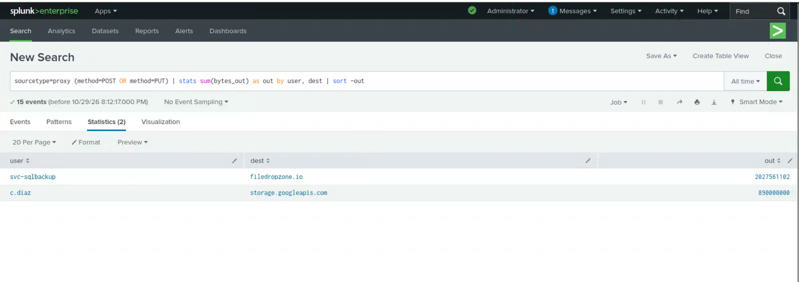

**2. Ruling out the second transfer.** The `c.diaz` upload was a single PUT at 15:12:00 from `10.20.6.7`, tagged `ci_build_artifact` in the log. It is a developer build upload and was ruled out.

```spl
sourcetype=proxy dest=storage.googleapis.com
```

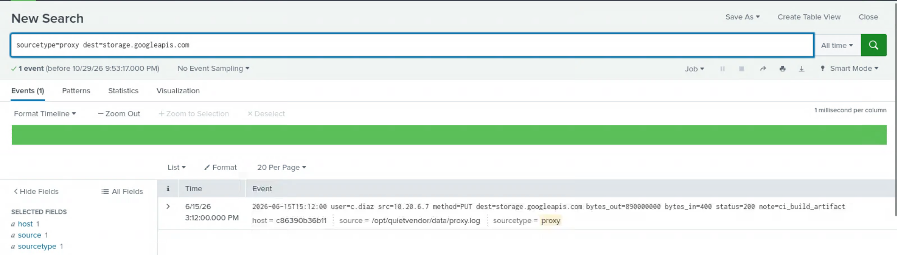

**3. The exfiltration pattern.** All 14 uploads came from `FS01` under `svc-sqlbackup` between 04:58:07 and 05:37:19, spaced 2 minutes 41 seconds to 3 minutes 39 seconds apart. Sizes range from 140,532,239 to 148,711,602 bytes and sum to the 2,027,561,102 bytes in step 1. Every event carries `note=large_upload` and `status=200`.

```spl
sourcetype=proxy dest="filedropzone.io" | table _time, user, src, dest, bytes_out, source
sourcetype=proxy dest=filedropzone.io method=POST
```

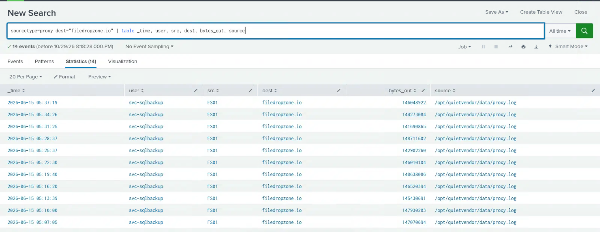

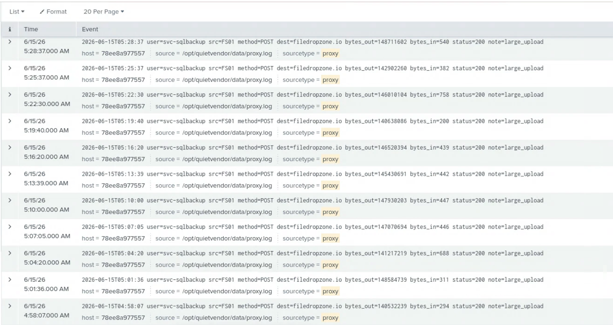

**4. How `svc-sqlbackup` was logged in.** A network logon (Type 3) to `FS01` from internal IP `10.20.99.20` at 02:56:00. An internal source means the account was reached by lateral movement and was not the entry point.

```spl
sourcetype=winsec TargetUserName=svc-sqlbackup EventCode=4624 | table _time, Computer, LogonType, IpAddress
```

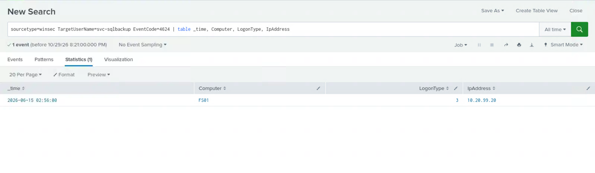

**5. Who held that IP.** All 13 VPN sessions for `10.20.99.20` belong to `svc-northwind`. The connection closest before the 02:56 logon is the 02:14 session from Romania. The account's other visible logins are from the US and fall between 12:23 and 17:02.

```spl
sourcetype=vpn "assigned_ip=10.20.99.20" | table _time, country, user, source
```

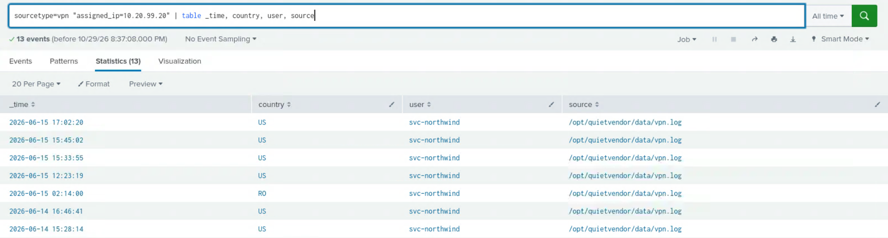

The 02:14 event records the source IP, the ASN and the note "first connection from this ASN".

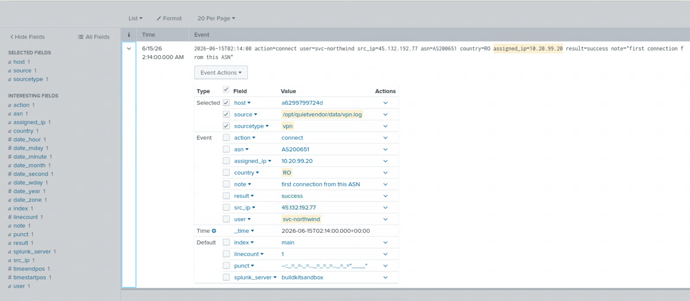

**6. Initial access.** Searching the mail gateway for high spam scores returned one message, delivered to `svc-northwind` three days before the VPN login.

```spl
sourcetype=mailgw spam_score>=5
```

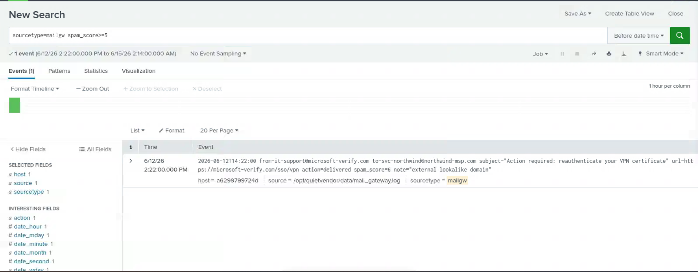

**7. Lateral movement technique.** Process creation events on `JUMP01` show six commands in 14 minutes, ending with Rubeus writing hashes to `hashes.txt`.

```spl
sourcetype=sysmon Computer=JUMP01 EventID=1 | table _time, Image, CommandLine
```

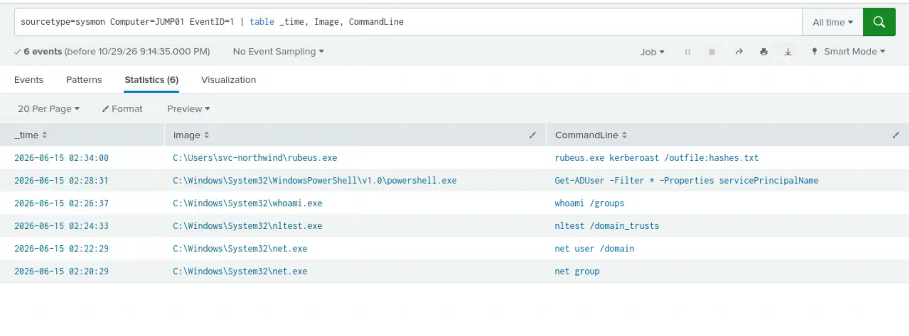

**8. Root cause on `FS01`.** Opening every field in the Linux auth events for `FS01` showed a `note` field recording root access via `no_root_squash`. The event it belongs to records `uid=0` reading `/export/finance/payroll_2026.xlsx` at 03:00:00.

```spl
sourcetype=linux_auth dvc=FS01
```

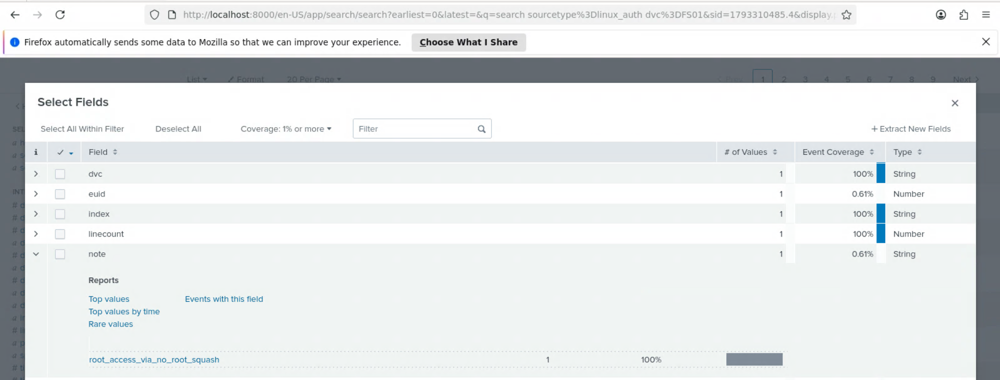

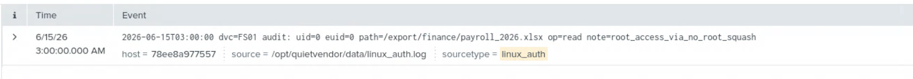

**9. Anti-forensics.** One event, performed by `svc-sqlbackup` on `FS01`, about 13 minutes after the final upload.

```spl
sourcetype=winsec EventCode=1102
```

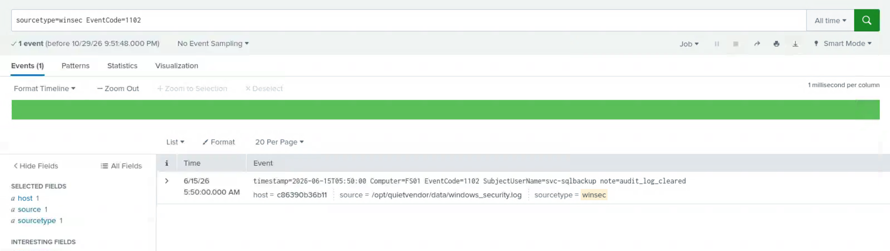

**10. Persistence.** Three searches, one per mechanism. The scheduled task is on `FS01` (03:11:00). The group change and the new account are both on `DC01` (03:13:00 and 03:14:00) and were made by `svc-northwind`.

```spl
sourcetype=winsec EventCode=4688 schtasks | table _time, Computer, CommandLine
sourcetype=winsec EventCode=4732 | table _time, TargetUserName, MemberName, SubjectUserName
sourcetype=winsec EventCode=4720
```

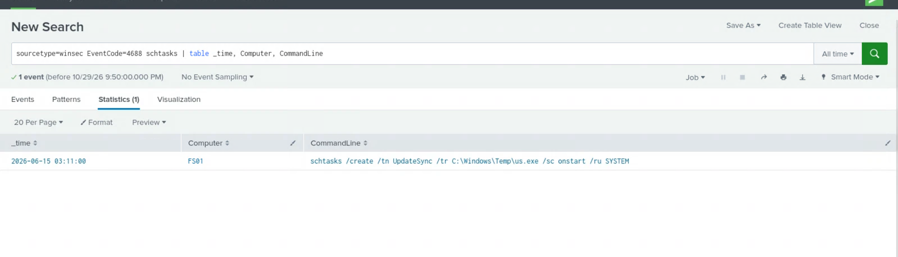

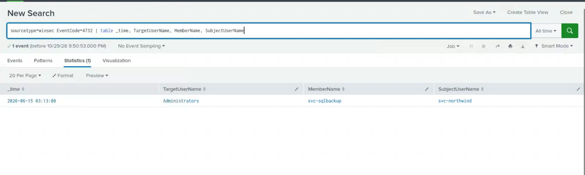

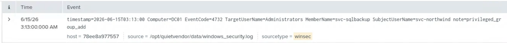

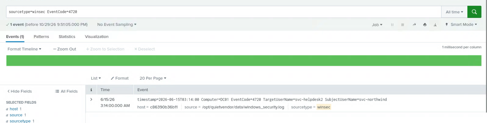

---

*Prepared for Hackrange Mentorship, Week 9: The Investigation, Operation Quiet Vendor.*
